

# Payment Service · CD Deployment Pipeline (`FinTech-Payment-CD-Microservice-Project`)

> **Programming language: Go.** This is a **Payment Service** microservice (the Java Spring Boot services are the Ledger; this service is written in Go).

This repo is the **CD side** of the Payment Service. It receives the image from the CI repo `FinTech-Payment-CI-Microservice-Project`, writes the new image into the environment values in Git, and Argo CD syncs the change to EKS. Git is the single source of truth.

> Status: **planned**. The workflow below is the design this repo will follow. No workflow file is committed yet.

---

## At a Glance

| Item | Value |
|---|---|
| Service | Payment Service |
| Language | Go |
| Repo role | CD (deploy through Git and Argo CD) |
| Companion repo | `FinTech-Payment-CI-Microservice-Project` |
| Steps | 12 |
| Tools | 9 |
| Diagrams | 12 animated diagrams in `docs/diagrams/` |

---

## Diagram Gallery

Each diagram is an animated SVG in `docs/diagrams/`. The moving dots show data flowing along the arrows. Each one has a short explanation.

### 01 · CD lifecycle

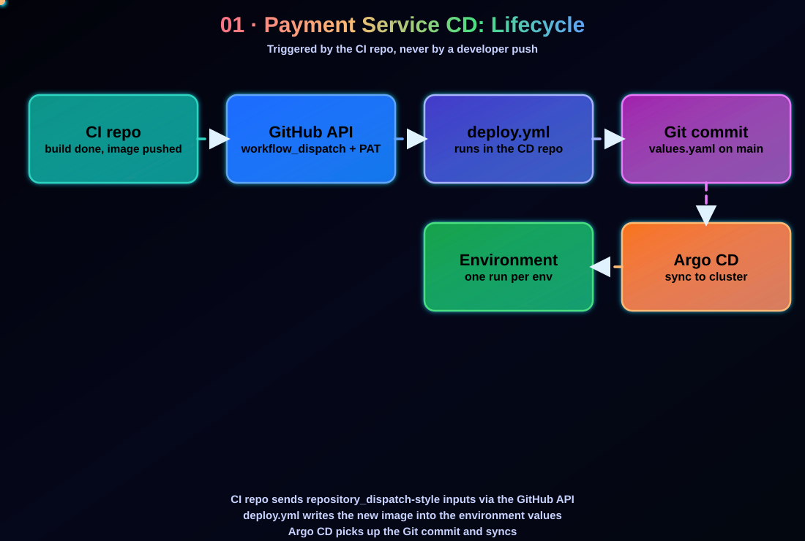

**What it shows:** The CI repo starts this workflow through the GitHub API. The workflow commits the new image to Git, and Argo CD picks it up.

### 02 · CD steps

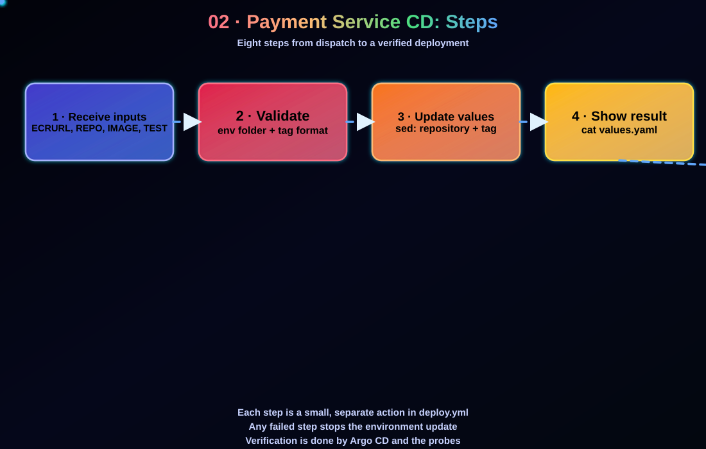

**What it shows:** Eight steps from dispatch to a verified rollout. Each step is a small action in deploy.yml.

### 03 · Receive inputs

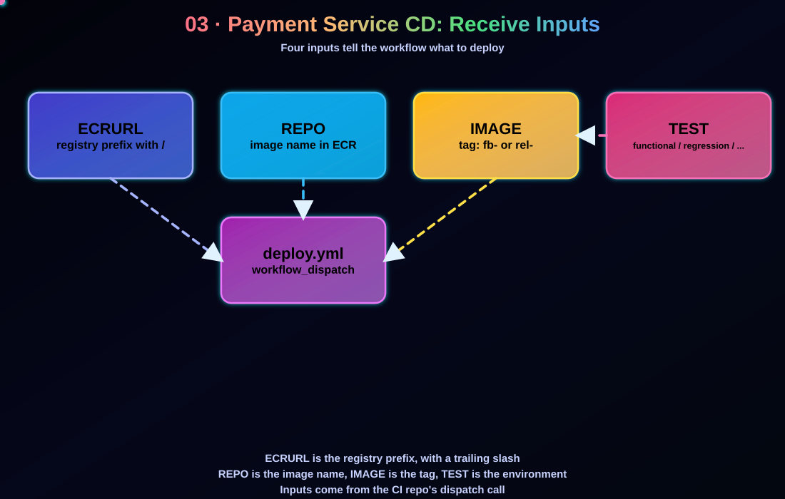

**What it shows:** The four inputs: the registry prefix, the image name, the image tag and the environment.

### 04 · Validate inputs

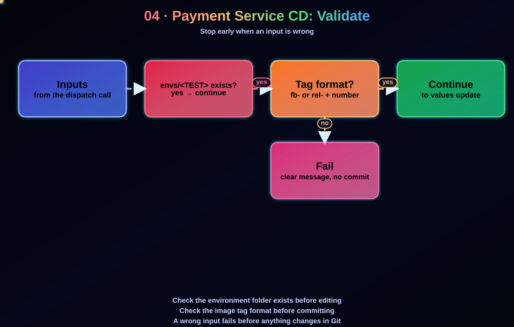

**What it shows:** The environment folder and the tag format are checked before anything is edited, so a bad input fails with no commit.

### 05 · Update values.yaml

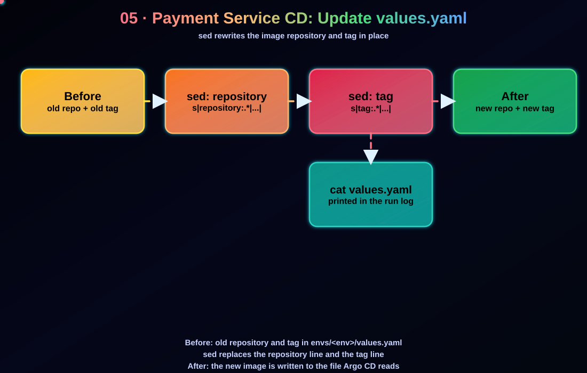

**What it shows:** sed replaces the repository and tag lines in the environment's values file. The new file is printed in the log.

### 06 · Commit and push

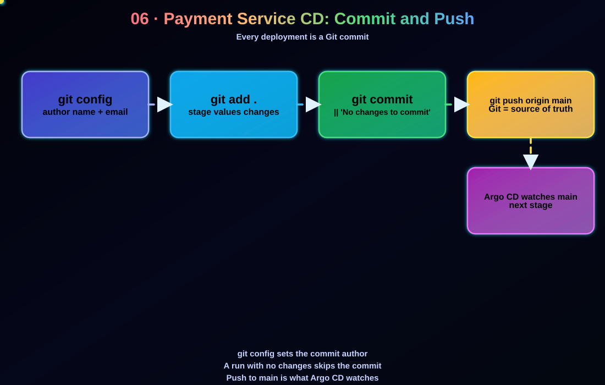

**What it shows:** Git records the change. A run with no change skips the commit. Pushing to main is what Argo CD watches.

### 07 · Argo CD detects and syncs

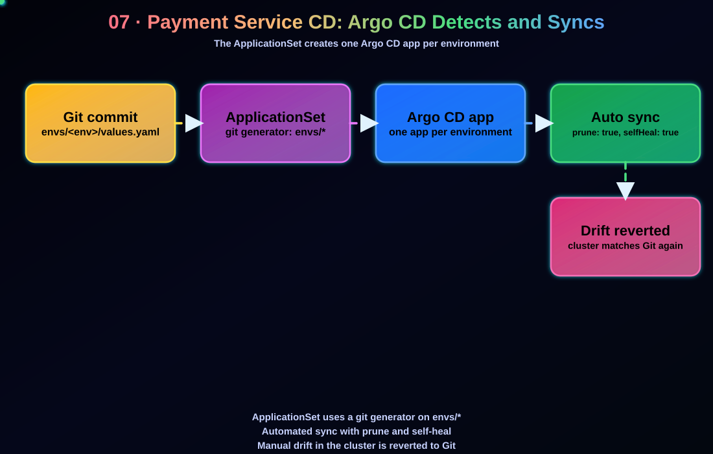

**What it shows:** The ApplicationSet has a git generator on envs/*. Auto sync with prune and self-heal keeps the cluster equal to Git.

### 08 · Helm render

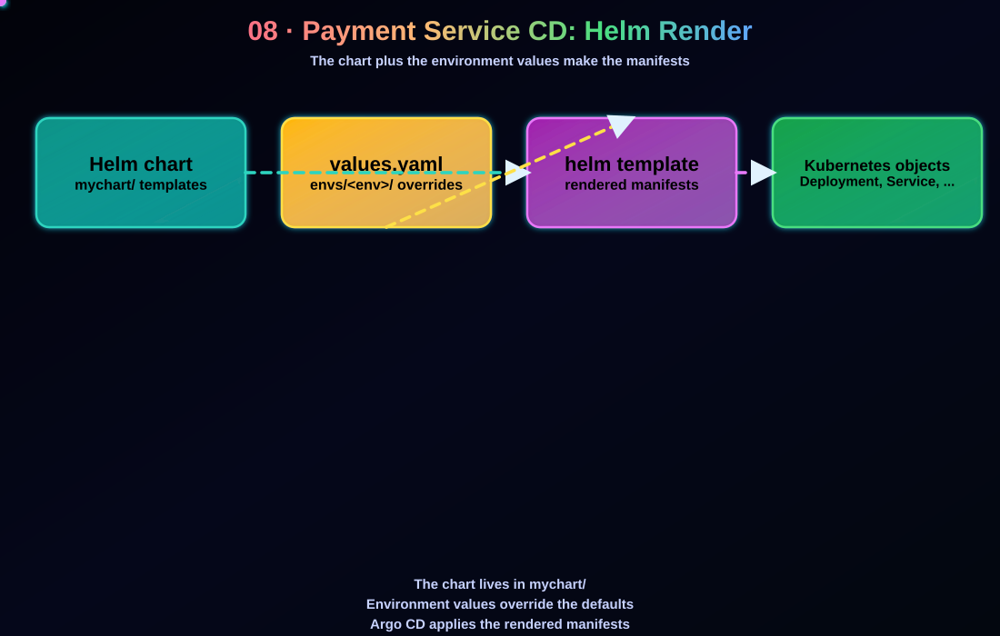

**What it shows:** The chart and the environment values produce the Kubernetes manifests that Argo CD applies.

### 09 · Rollout

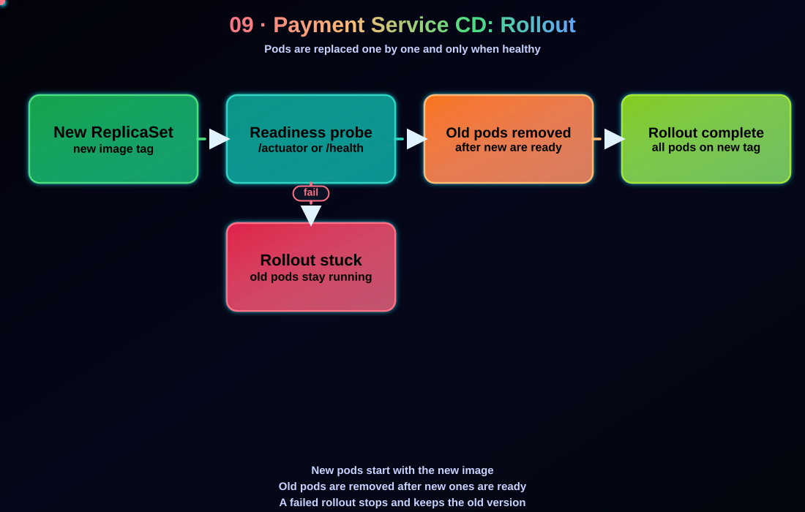

**What it shows:** New pods start with the new image. Old pods are removed only after the new ones are ready. A stuck rollout keeps the old version.

### 10 · Environment promotion

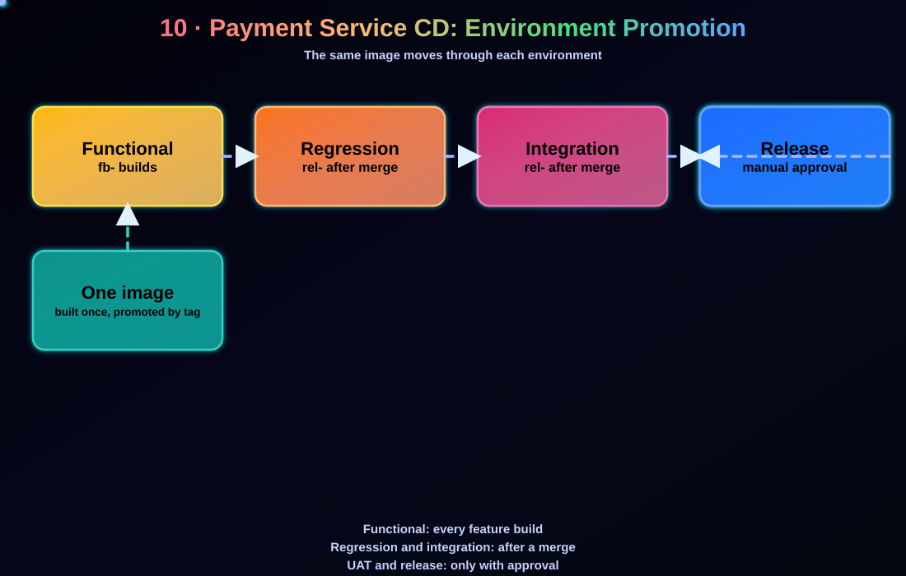

**What it shows:** The same image moves through functional, regression, integration, UAT and release.

### 11 · Health and rollback

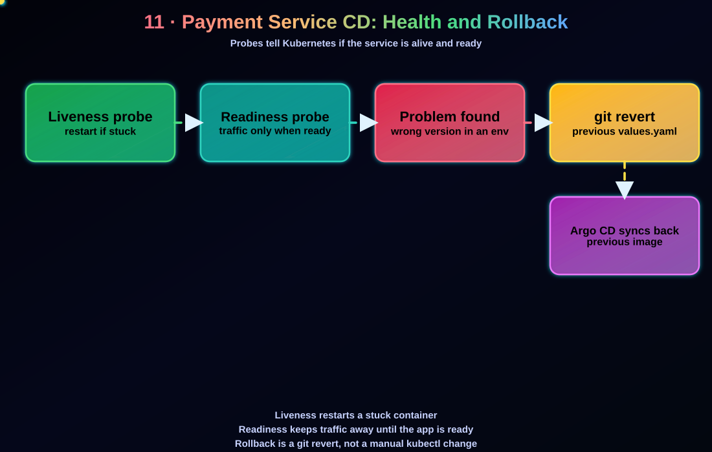

**What it shows:** Liveness restarts a stuck container. Readiness keeps traffic away until the app is ready. Rollback is a git revert.

### 12 · Secrets and access

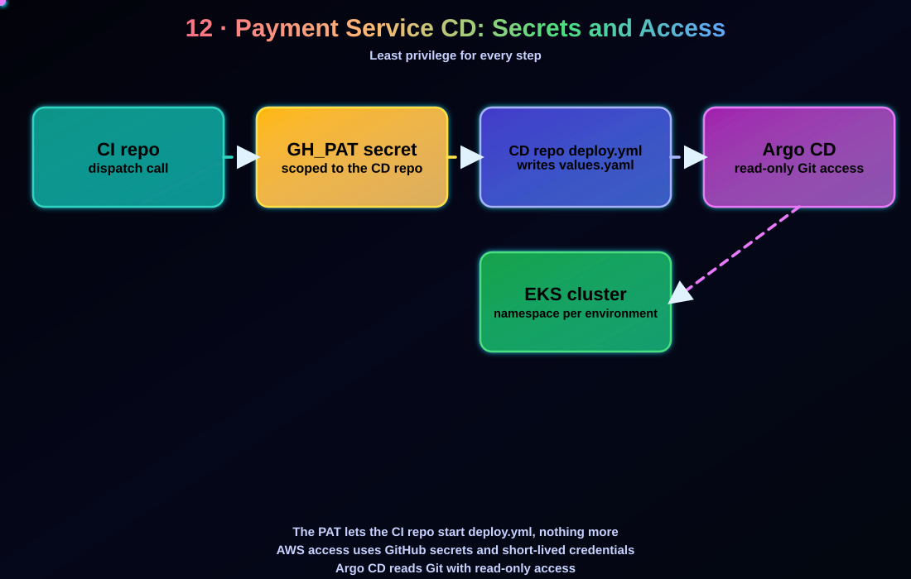

**What it shows:** The PAT can only start this workflow. Argo CD reads Git with read-only access.

---

## Steps

| # | Step | What it does | Tool |
|---|---|---|---|
| 1 | Receive inputs | ECRURL, REPO, IMAGE and TEST arrive from the CI repo's dispatch call | workflow_dispatch |
| 2 | Validate | Checks the environment folder exists and the tag format is right | Shell |
| 3 | Update values | sed rewrites the image repository and tag in envs/<env>/values.yaml | sed |
| 4 | Show result | Prints the new values file in the run log | cat |
| 5 | Commit | Commits the change with a clear message (skips if nothing changed) | git |
| 6 | Push | Pushes to main, which Argo CD watches | git push |
| 7 | Argo CD sync | ApplicationSet creates one app per envs/* folder and syncs it | Argo CD (GitOps) |
| 8 | Helm render | Renders the chart in mychart/ with the environment values | Helm |
| 9 | Rollout | New pods replace old pods only when they are ready | Kubernetes Deployment |
| 10 | Promotion | Functional, then regression, integration, UAT and release | Environment folders |
| 11 | Health and rollback | Probes keep bad pods out of traffic; rollback is a git revert | Liveness and readiness probes, git |
| 12 | Secrets and access | PAT scoped to this repo, read-only Git access for Argo CD | GitHub PAT, Argo CD |

---

## Tool Stack

| # | Tool | Category | What it does here |
|---|---|---|---|
| 1 | **GitHub Actions** | CD orchestration | Runs deploy.yml for each environment |
| 2 | **GitHub PAT (GH_PAT)** | Access | Lets `FinTech-Payment-CI-Microservice-Project` start this workflow |
| 3 | **sed** | File editing | Rewrites the image repository and tag |
| 4 | **Git** | Source of truth | Each deployment is a commit |
| 5 | **Argo CD** | GitOps CD | Syncs Git to EKS with auto sync and self-heal |
| 6 | **ApplicationSet** | Argo CD | One app per environment folder |
| 7 | **Helm** | Templating | Renders the chart with the values |
| 8 | **Kubernetes (EKS)** | Runtime | Runs the Payment Service pods per environment |
| 9 | **Liveness + readiness probes** | Health | Restart stuck pods, hold traffic until ready |

---

## Interview Talking Points

- Git is the source of truth: every deployment is a commit, and rollback is a revert.
- No manual kubectl changes to the cluster; Argo CD keeps it equal to Git.
- Least privilege: scoped PAT, read-only Git access for Argo CD.
- Promotion, not rebuild: the same image moves through each environment.

---

## Related Repos

- Companion repo: `FinTech-Payment-CI-Microservice-Project`
- Ledger service (Java Spring Boot) pipeline: `FinTech-Ledger-CI-MicroService-Project` and `FinTech-Ledger-CD-Microservice-Project`
